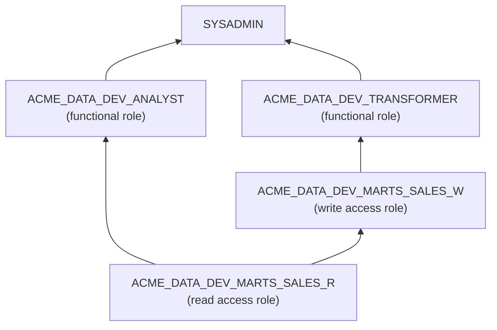

# Snowflake and Airflow Template

This template turns a [platform spec](spec.md) with `warehouse.type: snowflake` into a project you can apply with Terraform and build with dbt. Read this page to learn what it creates, how the roles fit together, and what you still do by hand.

!!! note "What the template generates today"
    - `terraform/`: databases, schemas, warehouses, roles and grants, plus a network policy, S3 storage integration and Okta sign-in when the spec asks for them.
    - `dbt/`: a dbt project that builds into those databases, with the spec's sources and one example model.

    Airflow (MWAA) code arrives in a later template version.

## What gets created

For a spec named `acme_data` with environments `dev` and `prod`, layers `raw`, `staging` and `marts`, and domains `sales` and `finance`:

| Object | Name pattern | Count in the example |
|--------|--------------|----------------------|
| Database | `ACME_DATA_<ENV>_<LAYER>` | 6 (2 environments x 3 layers) |
| Schema | `<DOMAIN>` in every database | 12 |
| Warehouse | `ACME_DATA_<ENV>_WH` | 2 |
| Access roles | `ACME_DATA_<ENV>_<LAYER>_<DOMAIN>_R` and `_W` | 24 (2 per schema) |
| Functional roles | `ACME_DATA_<ENV>_<ROLE>` | 2 per role in the spec |

Optional parts:

| The spec has | Terraform adds |
|--------------|----------------|
| `network.allowed_ips` | A network rule and network policy, in an `ACME_DATA_ADMIN` database. The policy is not attached. |
| `sources` | An S3 storage integration, `ACME_DATA_S3_LANDING`, allowed to read each source location. |
| `sso.provider: okta` | An Okta SAML integration, an Okta SCIM integration, and the `OKTA_PROVISIONER` role it runs as. |

## How the roles fit together

An arrow points from a role to the role it is granted to.

- **Access roles** hold privileges on one schema.
    - `_R` can use the database and schema, and select from all current and future tables and views.
    - `_W` also gets `_R`, can create tables, views, stages and file formats, and can insert, update, delete and truncate in all current and future tables.
- **Functional roles** come from `roles` in the spec. Each gets the `_R` or `_W` access role for every layer in its `access` and every domain in its `domains` (all domains when `domains` is left out), plus use of its environment's warehouse.
- **Everything rolls up to `SYSADMIN`**, so administrators can see and manage all of it.
- **Schemas use managed access.** Object owners cannot grant on their own objects; only the schema owner and roles with `MANAGE GRANTS` can. This keeps all grants in Terraform.

Give people and services functional roles only.

## Apply it

The generated `README.md` has the exact steps for your spec. In short:

1. Set Snowflake credentials as environment variables (`SNOWFLAKE_ORGANIZATION_NAME`, `SNOWFLAKE_ACCOUNT_NAME`, `SNOWFLAKE_USER`, `SNOWFLAKE_ROLE`, `SNOWFLAKE_AUTHENTICATOR`, `SNOWFLAKE_PRIVATE_KEY`). Never put them in files.
2. Add a Terraform state backend, such as S3, before sharing the project.
3. Create `platform.tfvars` if the spec has sources (`storage_aws_role_arn`) or Okta (`okta_saml_issuer`, `okta_sso_url`, `okta_x509_cert`). The generated `.gitignore` keeps `*.tfvars` out of git.
4. `terraform init`, `terraform plan -out plan.tfplan`, read the plan, then `terraform apply plan.tfplan`.

## What you do by hand

- **Trust policy for S3.** After apply, copy the outputs `storage_iam_user_arn` and `storage_external_id` into the trust policy of your IAM role.
- **Attach the network policy.** It is left unattached on purpose, because attaching it to the account blocks every other address, including other teams in the same account.
- **Okta SCIM token.** Generate it with `SYSTEM$GENERATE_SCIM_ACCESS_TOKEN` and paste it into the Okta app.
- **Grant functional roles to users**, or let Okta provisioning do it.

## The dbt project

`dbt/` targets dbt Core 1.12 with `dbt-snowflake` 1.12, installed from PyPI. It has one dbt target per environment in `profiles.yml`, with credentials from environment variables only.

**A model's folder decides where it builds.** Two macros, `generate_database_name` and `generate_schema_name`, read the layout from `vars` in `dbt_project.yml`:

| Model file | Builds in |
|------------|-----------|
| `models/staging/sales/stg_sales__orders.sql` | `ACME_DATA_<TARGET>_STAGING.SALES` |
| `models/marts/finance/fct_invoices.sql` | `ACME_DATA_<TARGET>_MARTS.FINANCE` |
| Anywhere else | The target database's `PUBLIC` schema, which the Terraform roles cannot write to |

So keep every model in `models/<layer>/<domain>/`. The landing layer (the first in `layers`, usually `raw`) is for loaded data only; dbt reads it through sources.

**What is generated:**

- `models/_sources.yml`: one dbt source per domain that has sources, pointing at the landing layer, one table per source.
- One example model, in `models/<second layer>/<domain>/`, selecting from the first source.
- `profiles.yml`: each target uses its environment's warehouse and, when the spec has a `transformer` role, defaults to that role. Without one, set `DBT_SNOWFLAKE_ROLE`.

Teams add their own models and tests from there. Loading the landing tables from S3 is not generated yet; it comes with the Airflow part.

## Provider version and preview features

The template pins the Snowflake provider to `snowflakedb/snowflake ~> 2.22`. In 2.22, network rules and the AWS storage integration are preview features, so the generated `providers.tf` turns them on only when the spec uses them. Preview features can change in minor provider releases.

## How the template is checked

`scripts/check_templates.py` renders the template for a full spec and a minimal one, then:

- runs `terraform fmt -check`, `terraform init` and `terraform validate`;
- checks every attribute reference against the provider schema, because `terraform validate` does not check references made through `for_each` keys;
- runs `dbt parse` and `dbt ls` with placeholder credentials, and fails if any generated model would build in `PUBLIC`.

CI runs it in the `templates` job. None of this connects to Snowflake.

It has not been planned, applied or built against a live Snowflake account yet. Run `terraform plan` and `dbt build` against a sandbox account before using it for real.

The design choices are recorded in [ADR 0012](../adr/0012-snowflake-template-design.md) (Terraform) and [ADR 0013](../adr/0013-dbt-project-layout.md) (dbt).
